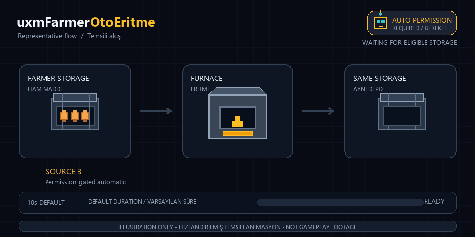

# uxmFarmerOtoEritme

[Türkçe](README.md)


[](LICENSE)

A Paper plugin that automatically smelts uncooked metal ores already in Farmer storage and deposits the output back into the same Farmer. A uxmFarmer-style menu shows stock, capacity, and active jobs, with manual smelting available too. Farmer classes are not used at compile time; event and API links are established at runtime through reflection.



*Illustrative workflow animation, not gameplay footage. It shows a Farmer with automatic permission but without instant permission. The animation is accelerated; the default operation takes 10 seconds.*

## Contents

- [Requirements and installation](#requirements-and-installation)
- [How it works](#how-it-works)
- [Farmer-style menu](#farmer-style-menu)
- [Configuration](#configuration)
- [Compatibility and event contracts](#compatibility-and-event-contracts)
- [Commands and permissions](#commands-and-permissions)
- [Troubleshooting](#troubleshooting)

## Requirements and installation

- Java 21 or newer is required on the server; Maven 3 is additionally required to build from source.
- The build target is Paper API 1.21.1; this is not a promise of runtime support for other Paper versions.
- Run `mvn clean verify` at the repository root, then copy `uxmfarmer-autosmelt/target/uxmFarmerOtoEritme.jar` to your server's `plugins/` directory. The config is created on first startup.
- No paid or proprietary Farmer JAR is required to compile. Third-party Farmer files are not included; the corresponding Farmer plugin must be installed on the running server.
- See [LICENSE](LICENSE) for the GPL-3.0-only license.

The repository contains a parent POM for shared build settings, a small `hook-common` helper module and the independent `uxmfarmer-autosmelt` plugin module. `hook-common` contains only the logger and is shaded/relocated under `com.blokoyun.hooks.farmersmelt.internal.common`. Do not install it separately; Paper and Farmer classes are not bundled. The Ax–Farmer bridge remains a separate repository/version/JAR.

Remove the previous JAR for this hook; never run two copies together. PlugMan unloading/reloading is unsupported; prefer a full server restart.

## How it works

With the default `automatic-smelting.enabled: true`, Farmer storage is scanned regularly. When its owner is online and has `uxmfarmerotosmelter.auto`, sufficient uncooked ore starts a job without clicking or keeping a menu open. It also works with the GUI disabled. Recipes are considered in rotation.

Raw, normal, and deepslate iron/gold/copper variants, plus Nether gold ore, are supported. Only metal-ore `plugin` recipes configured under `items` are automated; custom command recipes never dispatch automatic reward commands.

Manual smelting remains available through the `gui.slot` button. Automatic and manual jobs cannot overlap on the same Farmer, and one player cannot start two timed manual jobs. Timed manual jobs display a boss bar. Closing the menu keeps the job running.

Manual jobs check ownership/membership, `uxmfarmerotosmelter.use`, `gui.permission`, and the recipe permission. Automatic jobs check the owner's `automatic-smelting.permission` and any recipe permission at start and completion. Default VIP automation does not run offline; permission loss preserves the source. Quitting cancels manual jobs.

`uxmfarmerotosmelter.instant` skips the countdown for the initiating player in manual mode, or the Farmer owner in automatic mode. It grants neither automatic processing, GUI access, nor recipe permissions; capacity and amount checks remain. Instant automation completes on the first eligible scan, still respecting the scan interval and batch limit.

The default recipe converts raw iron (`RAW_IRON`) to iron ingots. For example, with 3 raw iron in storage, after 10 seconds 3 raw iron are debited from the same Farmer and its `IRON_INGOT` stock increases by 3. **No items are given to the player's inventory.** Resources are not consumed during the countdown. `RAW_IRON` and `IRON_ORE` stock are separate.

Iron ores become `IRON_INGOT`, gold ores `GOLD_INGOT`, and copper ores `COPPER_INGOT` in the same storage. The source must already be in Farmer storage; this plugin does not collect dropped items. The output material must be defined in Farmer's `collected-materials.yml`. If destination capacity is insufficient, the operation stops without consuming the source.

## Farmer-style menu

The default menu has 6 rows: a gray-glass frame, 28 central product slots, and separate controls. Product lore shows source stock, output stock/capacity, batch amount, and duration. The menu displays automatic processing status and active-job progress. Back returns to the Farmer main menu; pagination and refresh controls do not collide with product slots.

Stock and progress values refresh when opening the menu or clicking **Refresh**. Product names follow the Minecraft client's language.

Use `gui.title` / `gui.filler-material` to configure the title and filler. New defaults follow uxmFarmer's MiniMessage colors; existing custom text using `&` color codes is also supported.

## Configuration

The config is created at `plugins/uxmFarmerOtoEritme/config.yml`; packaged defaults are in [config.yml](uxmfarmer-autosmelt/src/main/resources/config.yml).

- Keys under `items` are Bukkit `Material` names (case-insensitive).
- The default `mode: plugin` debits the source and stores `output-material` in **the same Farmer**, without executing player reward commands. If omitted, recognized materials use their default smelting mapping. Invalid fields, types or recipes fail explicitly; components are not activated with invalid configuration. The optional `mode: commands` debits the source and executes a custom `commands` list from the console.
- `min-amount`, `max-amount` (`0` means unlimited), `duration-seconds`, and `batch-size` can be set per item. `batch-size: 0` means the entire suitable stock.
- `automatic-smelting.enabled` controls storage-based automatic smelting; `interval-ticks` is the scan interval (default: 20 ticks).
- `automatic-smelting.permission` defaults to `uxmfarmerotosmelter.auto`. Set `''` to allow everyone; offline processing is then possible when no additional recipe permission is required.
- `instant-smelting.permission` defaults to `uxmfarmerotosmelter.instant`; `''` disables instant processing.
- Command placeholders are `%player%`, `%uuid%`, `%owner%`, `%item%`, `%amount%`, `%farmer_uuid%`, and their brace-wrapped equivalents.
- `gui.rows` controls the smelting menu size; the farmer main menu does not need to have the same size. `gui.slot` is the button position in the farmer main menu; an occupied active button is never overwritten. The default slot is `7`, a filler slot in UXMFarmer 3.18's main menu.
- GUI size is constrained to 3–6 rows; the default 6-row layout shows 28 products. Slot and occupied-inventory safety checks remain in place.

Startup or reload upgrades old configs to `config-version: 4`. Missing VIP permission fields are added while custom permission values are preserved. Upgrading from v3 does not change recipes. Older versions also migrate bundled inventory rewards to storage recipes and add the v3 ore variants; custom recipes/text are retained.

`config-version` is the schema version only. Configuration is read directly from disk into immutable settings; resource defaults do not restore removed recipes. Existing files are not overwritten on startup; migrations change only the required fields. Product capacities, prices, membership and permission rules come from Farmer's API; the recipes/GUI/permissions here configure bridge behavior only.

`trigger: automatic` enables the old collection-event/command hook; **it does not control storage-based automatic smelting**. The new processing loop uses `automatic-smelting.enabled`. If Farmer loads late, the processing and GUI connections are retried automatically.

A fragment of the default raw iron recipe:

```yaml
trigger: click
automatic-smelting:
  enabled: true
  interval-ticks: 20
  permission: uxmfarmerotosmelter.auto
instant-smelting:
  permission: uxmfarmerotosmelter.instant
gui:
  title: '<black><bold>Oto Eritme'
  filler-material: GRAY_STAINED_GLASS_PANE
  rows: 6
  slot: 7
  duration-seconds: 10
  batch-size: 64
items:
  RAW_IRON:
    mode: plugin
    output-material: IRON_INGOT
    min-amount: 1
```

## Compatibility and event contracts

The GUI hook automatically looks for UXMFarmer 3.18's `com.uxplima.uxmfarmer.api.event.impl.FarmerOpenMainMenuEvent` or legacy Farmer v6's `xyz.geik.farmer.api.handlers.FarmerMainGuiOpenEvent`. The UXMFarmer 3.18 plugin name is `uxmFarmer`; the legacy `Farmer` name in older configs is also supported.

Storage-based automatic smelting uses modern UXMFarmer 3.18's storage/enumeration API. Legacy Farmer versions without that API explicitly report automatic processing as unavailable; the manual menu integration remains supported.

`hook.plugin-name` selects the dependency; `hook.event-class` selects the **collection event for automatic mode**, not the GUI opening event. Check event and storage API compatibility separately when using another fork.

Folia is not supported. A live server running Paper 26.2 or Java 25 has not been verified; targeting Java 21 does not by itself guarantee server compatibility.

## Commands and permissions

- `/uxmfarmerotosmelter reload` — reloads the config; `/otoeritme` and `farmerotosmelter` are aliases.
- `/otoeritme status` — reports the Farmer connection, menu state, and automatic smelting status.
- `uxmfarmerotosmelter.use` — start smelting from the GUI (default: op).
- `uxmfarmerotosmelter.admin` — reload and administration (default: op).
- `uxmfarmerotosmelter.auto` — automatic processing for the Farmer owner (default: false, including operators).
- `uxmfarmerotosmelter.instant` — skip the countdown (default: false; automatic permission is still separate).

With LuckPerms, explicitly grant these to the VIP group:

```text
lp group vip permission set uxmfarmerotosmelter.use true
lp group vip permission set uxmfarmerotosmelter.auto true
lp group vip permission set uxmfarmerotosmelter.instant true
```

Grant `uxmfarmerotosmelter.use` separately to normal groups that should use timed manual smelting. VIP benefits do not require the `admin` permission.

Reload or plugin shutdown closes open smelting menus; all active jobs are cancelled without consuming resources. Normal menu closing does not cancel a job. The connection is retried if Farmer loads late; quitting cancels only the player's manual job.

The startup/shutdown robot banner uses the actual plugin name and Maven version; platform and elapsed time are obtained at runtime. Missing dependencies and API/configuration failures never produce successful startup output. Reload/shutdown cleans only this hook's task handles and listener instances; a cleanup failure does not prevent remaining resources from being closed.

## Verification

43 tests passed, covering stock transfers/rollback, automatic and instant VIP permissions, modern/legacy GUI integration, startup-bound event APIs and configuration migration/validation.

An isolated Leaf 26.2 / Java 25 run exercised the packaged JAR's robot banner, missing-Farmer waiting state, `status`/`reload`, `enabled: false`, malformed boolean rejection, recovery and clean shutdown. A standalone fault-injection smoke program confirmed that retry/GUI cleanup failures do not skip remaining listener/task cleanup or report false success. Live-player GUI interaction and world/region transfers with a real Farmer installation were not exercised.


## Troubleshooting

| Symptom | Check |
| --- | --- |
| Auto-smelting button is missing | Check `/otoeritme status`, `gui.enabled`, and the startup log line `Farmer GUI oto eritme düğmesi aktif`. |
| GUI connection is active, but no button appears | `gui.slot` must be empty or a filler slot in the farmer main menu; active buttons are not overwritten. |
| A player cannot start smelting | Check farmer ownership/membership, `uxmfarmerotosmelter.use`, `gui.permission`, and the recipe's additional permission. |
| A recipe is missing from the menu | Check the Material name, `output-material` or command list, and skipped-recipe warnings in the log. |
| Smelting does not complete | Check source stock, the output material's Farmer configuration, destination capacity, and access permissions at completion. |
| Stored ores are not processed automatically | Check `automatic-smelting.enabled`, whether the owner is online with `automatic-smelting.permission`, any recipe permission, `plugin` mode, and destination capacity. |
| A custom recipe's command fails, but stock was debited | Command side effects cannot be rolled back; the source is deliberately not refunded. Check the console command and failure log. Default storage-based recipes do not execute commands. |

If Farmer is disabled by a license, database, or other startup error, fix Farmer's own startup error first. Include the server, Java, and Farmer versions, `/otoeritme status`, and the relevant console error when reporting a problem.
