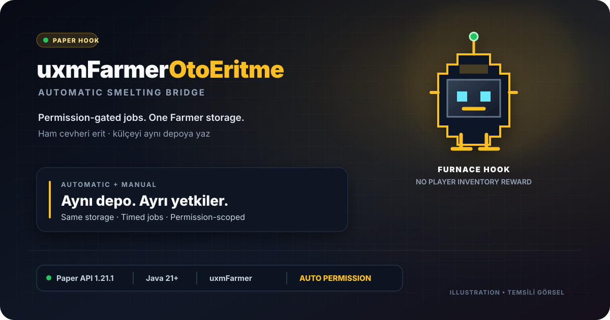

# uxmFarmerOtoEritme

[English](README.en.md)



[](https://github.com/SerhatDew/uxmfarmer-autosmelt/releases/latest)

[**Son sürüm JAR'ını indir**](https://github.com/SerhatDew/uxmfarmer-autosmelt/releases/latest/download/uxmFarmerOtoEritme.jar) · [Sürüm notları ve SHA-256](https://github.com/SerhatDew/uxmfarmer-autosmelt/releases/latest)


[](LICENSE)

## Kısa bakış

- **Depo odaklı:** Ham cevheri Farmer deposundan düşer, külçeyi aynı depoya yazar; oyuncu envanterine ödül vermez.
- **İzin kontrollü:** Otomatik çalışma Farmer sahibinin `uxmfarmerotosmelter.auto` iznine bağlıdır; `instant` yalnızca beklemeyi atlar ve otomatiği tek başına açmaz.
- **Esnek kullanım:** 10 saniyelik varsayılan işlem, manuel GUI, tarif bazlı kapasite/izin kontrolleri ve çalışma anında reflection ile Farmer bağlantısı.


*Temsili işleyiş animasyonu; oyun içi kayıt değildir. Otomatik izni verilmiş, beklemesiz izni olmayan bir Farmer'ı gösterir. Animasyon hızlandırılmıştır; varsayılan işlem süresi 10 saniyedir.*

## İçindekiler

- [Gereksinimler ve kurulum](#gereksinimler-ve-kurulum)
- [Çalışma şekli](#çalışma-şekli)
- [Farmer tarzı menü](#farmer-tarzı-menü)
- [Yapılandırma](#yapılandırma)
- [Uyumluluk ve event sözleşmeleri](#uyumluluk-ve-event-sözleşmeleri)
- [Komutlar ve izinler](#komutlar-ve-izinler)
- [Sorun giderme](#sorun-giderme)

## Gereksinimler ve kurulum

- Sunucuda Java 21 veya üzeri gerekir; kaynaktan derleme için ayrıca Maven 3 kullanılır.
- Hazır JAR için [en yeni release'i](https://github.com/SerhatDew/uxmfarmer-autosmelt/releases/latest) kullanın; **Source code** arşivini sunucuya kurmayın.
- Derleme hedefi Paper API 1.21.1'dir; bu, diğer Paper sürümlerinde çalışma garantisi değildir.
- Repo kökünde `mvn clean verify` çalıştırın ve `target/uxmFarmerOtoEritme.jar` dosyasını sunucunuzun `plugins/` klasörüne kopyalayın. İlk açılışta config oluşturulur.
- Derleme için ücretli veya özel Farmer JAR'ı gerekmez. Üçüncü taraf Farmer dosyaları bu projeye dahil değildir; çalışan sunucuda ilgili Farmer eklentisi bulunmalıdır.
- GPL-3.0-only lisansı için [LICENSE](LICENSE) dosyasına bakın.
Aynı hook'un eski JAR'ını kaldırın; iki kopyayı birlikte çalıştırmayın. PlugMan ile söküp takma desteklenmez; tam sunucu yeniden başlatması tercih edilir.

## Çalışma şekli

Varsayılan `automatic-smelting.enabled: true` ayarında Farmer depoları düzenli taranır. Sahibi çevrimiçi ve `uxmfarmerotosmelter.auto` iznine sahip olan Farmer'da uygun miktarda pişmemiş cevher bulunduğunda eritme otomatik başlar; menüye tıklamak veya menüyü açık tutmak gerekmez. GUI kapalıyken de çalışır. Tarifler sırayla değerlendirilir.

Demir, altın ve bakırın ham, normal cevher ve derin kayrak varyantları ile Nether altın cevheri desteklenir. Yalnızca `items` altında tanımlı metal cevheri `plugin` tarifleri otomatik işlenir; özel komut tarifleri otomatik komut çalıştırmaz.

Farmer ana menüsündeki `gui.slot` düğmesinden manuel işlem başlatmak da mümkündür. Aynı Farmer'da otomatik ve manuel işlemler çakışamaz; aynı oyuncu iki süreli manuel işlem başlatamaz. Süreli manuel işlemler boss bar gösterir. Menü kapatılınca işlem devam eder.

Manuel kullanımda sahip/üye ilişkisi, `uxmfarmerotosmelter.use`, `gui.permission` ve tarif izni kontrol edilir. Otomatik kullanımda Farmer sahibinin `automatic-smelting.permission` ve varsa tarif izni başlangıçta ve tamamlanırken kontrol edilir. Varsayılan VIP otomatiği çevrimdışıyken çalışmaz; izin kaybında kaynak tüketilmez. Manuel işlem oyuncu çıkınca iptal edilir.

`uxmfarmerotosmelter.instant` izni manuel kullanımda işlemi başlatan oyuncunun, otomatik kullanımda Farmer sahibinin beklemesini kaldırır. Tek başına otomatik çalışma, GUI erişimi veya tarif izni vermez; kapasite ve miktar kontrolleri korunur. Otomatik beklemesiz işlem ilk uygun taramada tamamlanır; tarama aralığı ve parti sınırı devam eder.

Varsayılan tarif ham demirden (`RAW_IRON`) demir külçesi üretir. Örneğin depoda 3 ham demir varsa, 10 saniye sonunda aynı Farmer deposundan 3 ham demir düşülür ve depodaki `IRON_INGOT` miktarı 3 artırılır. **Oyuncu envanterine eşya verilmez.** Bekleme sırasında kaynak tüketilmez. `RAW_IRON` ve `IRON_ORE` stokları birbirine karıştırılmaz.

Demir cevherleri `IRON_INGOT`, altın cevherleri `GOLD_INGOT`, bakır cevherleri `COPPER_INGOT` olarak aynı Farmer deposuna eklenir. Kaynak zaten Farmer deposunda bulunmalıdır; bu eklenti yere düşen eşyaları toplamaz. Çıktı malzemesi Farmer'ın `collected-materials.yml` dosyasında tanımlı olmalıdır; tanımsız çıktı kaydı oluşturulmaz ve işlem kaynak tüketmeden durur. Hedef ürün kapasitesi yetersizse işlem kaynak tüketmeden durur.

## Farmer tarzı menü

Varsayılan menü 6 satırdır: gri cam çerçeve, ortada 28 ürün slotu ve ayrı kontrol alanları. Ürün açıklamaları kaynak stoğunu, çıktı deposunu/kapasitesini, işlem miktarını ve süresini gösterir. Otomatik eritme durumu ve aktif işlem ilerlemesi menüden görülebilir. Geri düğmesi Farmer ana menüsüne döner; sayfalama ve yenileme düğmeleri ürün slotlarıyla çakışmaz.

Stok ve ilerleme değerleri menü açıldığında veya **Yenile** düğmesine basıldığında güncellenir. Ürün adları Minecraft istemcisinin dilinde gösterilir.

Başlık ve dolgu malzemesi `gui.title` / `gui.filler-material` ile ayarlanır. Yeni varsayılanlar uxmFarmer'ın MiniMessage renklerini kullanır; mevcut özel `&` renk kodlu metinler de okunur.

## Yapılandırma

- Ayar dosyası `plugins/uxmFarmerOtoEritme/config.yml` konumunda oluşturulur; paketlenen varsayılanlar [config.yml](src/main/resources/config.yml) dosyasındadır.

- `items` anahtarları Bukkit `Material` adlarıdır (büyük/küçük harf fark etmez).
- Varsayılan `mode: plugin`, kaynağı düşürüp `output-material` ürününü **aynı Farmer deposuna** ekler; oyuncuya ödül komutu çalıştırmaz. Alan verilmezse tanınan malzemelerin varsayılan eritme eşleşmesi kullanılır. Geçersiz alan, tür veya tarif açık hata verir; hatalı config ile bileşenler etkinleştirilmez. İsteğe bağlı `mode: commands`, kaynağı düşürüp özel `commands` listesini konsoldan çalıştırır.
- `min-amount`, `max-amount` (`0` sınırsız), `duration-seconds` ve `batch-size` item başına ayarlanabilir. `batch-size: 0`, uygun stoğun tamamıdır.
- `automatic-smelting.enabled` depodan otomatik eritmenin anahtarıdır; `interval-ticks` tarama aralığıdır (varsayılan: 20 tick).
- `automatic-smelting.permission` varsayılan olarak `uxmfarmerotosmelter.auto` ister. `''` verilirse otomatik eritme herkese açılır; ek tarif izni yoksa çevrimdışı da çalışabilir.
- `instant-smelting.permission` varsayılan olarak `uxmfarmerotosmelter.instant` ister; `''` beklemesiz özelliğini kapatır.
- Komut yer tutucuları `%player%`, `%uuid%`, `%owner%`, `%item%`, `%amount%`, `%farmer_uuid%` ve süslü parantezli karşılıklarıdır.
- `gui.rows` eritme menüsünün boyutudur; farmer ana menüsünün aynı boyutta olması gerekmez. `gui.slot` farmer ana menüsündeki düğme yeridir; dolu aktif bir düğmenin üzerine yazılmaz. Varsayılan slot `7`, UXMFarmer 3.18 ana menüsünde dolgu slotudur.
- GUI boyutu 3–6 satırla sınırlıdır; varsayılan 6 satırda 28 ürün gösterilir. Slot ve dolu/işgal edilmiş menü güvenliği kontrol edilir.

Eski config açılışta veya reload sırasında `config-version: 4`'e güncellenir. Eksik VIP izin alanları eklenir; özel izin değerleri korunur. v3'ten yükseltme tariflere dokunmaz. Daha eski sürümlerdeki varsayılan envantere verme tarifleri depoya yazan tariflere dönüştürülür ve v3 cevher varyantları eklenir; özel tarifler/metinler korunur.

`config-version` yalnızca şema sürümüdür. Config doğrudan diskten okunup değişmez ayar nesnesine dönüştürülür; paket varsayılanları silinmiş tarifleri geri eklemez. Açılışta mevcut dosya ezilmez; yalnızca gerekli alanlar taşınır. Ürün kapasitesi, fiyat, üyelik ve izin kuralları Farmer API'sinden alınır; buradaki tarif/GUI/izin alanları yalnızca köprünün davranışıdır.

`trigger: automatic` eski toplama-event/komut hook'unu açar; **depodan otomatik eritme ayarı değildir**. Yeni depodan eritme `automatic-smelting.enabled` ile kontrol edilir. Farmer sunucu açılışında geç gelirse işlem ve GUI bağlantısı otomatik olarak yeniden denenir.

Varsayılan ham demir tarifinden bir kesit:

```yaml
trigger: click
automatic-smelting:
  enabled: true
  interval-ticks: 20
  permission: uxmfarmerotosmelter.auto
instant-smelting:
  permission: uxmfarmerotosmelter.instant
gui:
  title: '<black><bold>Oto Eritme'
  filler-material: GRAY_STAINED_GLASS_PANE
  rows: 6
  slot: 7
  duration-seconds: 10
  batch-size: 64
items:
  RAW_IRON:
    mode: plugin
    output-material: IRON_INGOT
    min-amount: 1
```

## Uyumluluk ve event sözleşmeleri

GUI bağlantısı UXMFarmer 3.18 için `com.uxplima.uxmfarmer.api.event.impl.FarmerOpenMainMenuEvent`, legacy Farmer v6 için `xyz.geik.farmer.api.handlers.FarmerMainGuiOpenEvent` sınıfını otomatik arar. UXMFarmer 3.18'in eklenti adı `uxmFarmer`'dır; eski config'lerdeki `Farmer` adı da desteklenir.

Depodan otomatik eritme modern UXMFarmer 3.18'in depo/listeleme API'sini kullanır. Bu API'si bulunmayan legacy Farmer sürümlerinde otomatik çalışma açıkça kullanılamaz olarak bildirilir; manuel menü bağlantısı korunur.

`hook.plugin-name` bağımlı eklentiyi, `hook.event-class` ise **automatic modunun toplama olayını** seçer; GUI açılış olayı bu ayarla değiştirilmez. Başka bir fork kullanırken event ve depolama API'sinin uyumunu ayrıca kontrol edin.

Folia desteklenmez. Paper 26.2 ve Java 25 ile canlı sunucu çalışması doğrulanmamıştır; Java 21 derleme hedefi tek başına sunucu uyumluluğu garantisi değildir.

## Komutlar ve izinler

- `/uxmfarmerotosmelter reload` — config'i yeniden yükler; `/otoeritme` ve `farmerotosmelter` alias'ları vardır.
- `/otoeritme status` — Farmer bağlantısını, menü durumunu ve otomatik eritmenin durumunu gösterir.
- `uxmfarmerotosmelter.use` — GUI'den eritme başlatma (varsayılan: op).
- `uxmfarmerotosmelter.admin` — reload ve yönetim (varsayılan: op).
- `uxmfarmerotosmelter.auto` — Farmer sahibine otomatik eritme (varsayılan: false; OP dahil kendiliğinden verilmez).
- `uxmfarmerotosmelter.instant` — işlem süresini atlama (varsayılan: false; otomatik izin ayrıca gerekir).

LuckPerms kullanıyorsanız VIP grubuna açıkça verin:

```text
lp group vip permission set uxmfarmerotosmelter.use true
lp group vip permission set uxmfarmerotosmelter.auto true
lp group vip permission set uxmfarmerotosmelter.instant true
```

Normal oyuncuların manuel eritmesi için `uxmfarmerotosmelter.use` iznini ilgili gruba ayrıca verin. VIP avantajları için `admin` izni gerekmez.

Reload veya eklentinin kapanması sırasında açık eritme menüleri kapanır; devam eden tüm işlemler kaynak tüketmeden iptal edilir. Normal menü kapatma işlemi iptal etmez. Farmer'ın geç açılması durumunda bağlantı yeniden denenir; oyuncunun bağlantısı koparsa yalnızca manuel işlemi iptal edilir.

Açılış/kapanış robot bannerı pluginin gerçek adı ve Maven sürümünü kullanır; platform ve süre çalışma anında alınır. Bağımlılık beklenirken veya API/config hatası oluştuğunda başarı mesajı yazılmaz. Reload/kapanış yalnızca bu hook'un task handle'larını ve listener örneklerini temizler; bir temizlik hatası diğer kaynakların kapatılmasını engellemez.

## Doğrulama

43 test geçti: depo aktarımı/geri alma, otomatik ve anlık VIP izinleri, modern/legacy GUI bağlantısı, başlangıçta bağlanan event API'si ve config geçişi/doğrulaması.

İzole Leaf 26.2 / Java 25 çalıştırmasında paketlenmiş JAR ile robot bannerı, Farmer yokken bekleme, `status`/`reload`, `enabled: false`, hatalı boolean reddi, düzeltme sonrası toparlanma ve temiz kapanış doğrulandı. Ayrı fault-injection smoke programında retry/GUI temizliği hata verse de diğer listener/taskların kapatıldığı ve yanlış başarı mesajı yazılmadığı gözlendi. Canlı oyuncuyla GUI etkileşimi ve gerçek Farmer kurulumunda dünya/bölge aktarımı bu çalıştırmanın kapsamına girmedi.


## Sorun giderme

| Belirti | Kontrol |
| --- | --- |
| Oto eritme düğmesi görünmüyor | `/otoeritme status`, `gui.enabled` ve başlangıç logundaki `Farmer GUI oto eritme düğmesi aktif` satırını kontrol edin. |
| Menü bağlantısı aktif ama düğme yok | `gui.slot` farmer ana menüsünde boş veya dolgu slotu olmalıdır; aktif düğmelerin üzerine yazılmaz. |
| Oyuncu işlem başlatamıyor | Farmer sahibi/üye ilişkisini, `uxmfarmerotosmelter.use`, `gui.permission` ve tarifin ek iznini kontrol edin. |
| Bir tarif menüde görünmüyor | Material adını, `output-material` veya komut listesini ve logdaki atlanan tarif uyarısını kontrol edin. |
| Eritme tamamlanmıyor | Kaynak miktarını, çıktı malzemesinin Farmer'da tanımlı olmasını, hedef depo kapasitesini ve tamamlanma anındaki erişim izinlerini kontrol edin. |
| Depodaki cevherler otomatik işlenmiyor | `automatic-smelting.enabled`, Farmer sahibinin çevrimiçi ve `automatic-smelting.permission` iznine sahip olması, tarifin ek izni, `plugin` modu ve depo kapasitesini kontrol edin. |
| Özel komut tarifinde komut başarısız ama kaynak düşmüş | Komutların yan etkileri geri alınamaz; kaynak bilerek iade edilmez. Konsol komutunu ve hata logunu kontrol edin. Varsayılan depoya eritme tarifleri komut çalıştırmaz. |

Farmer lisans, veritabanı veya başka bir başlangıç hatası nedeniyle devre dışıysa önce Farmer'ın kendi başlangıç hatasını giderin. Sorun bildirirken sunucu, Java ve Farmer sürümleriyle `/otoeritme status` çıktısını ve ilgili konsol hatasını ekleyin.
